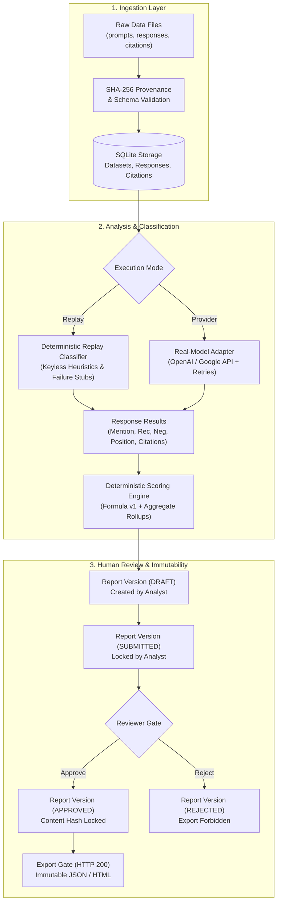
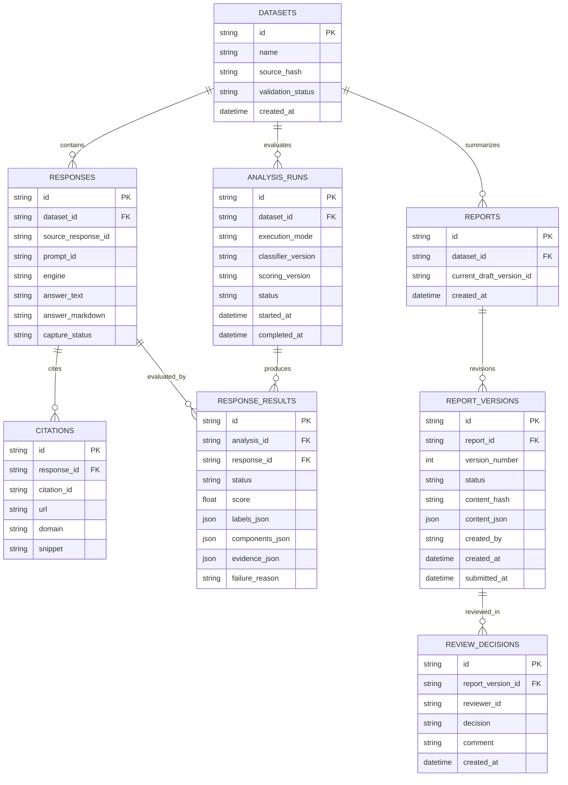

# System Architecture & Technical Design

## 1. High-Level Architecture Overview

The Kasparro AI Visibility Analysis & Human Review service is a production-grade FastAPI backend designed for reproducible, evidence-backed evaluation of brand visibility across Generative AI answer engines (OpenAI ChatGPT, Google Gemini, and Google AI Mode).



---

## 2. Relational Database Schema (SQLite)

The persistence layer uses SQLite managed via SQLAlchemy ORM. The relational model enforces strict referential integrity, foreign key constraints, and audit trails across 8 tables:



---

## 3. Directory Layout & Module Responsibilities

The codebase follows a modular single-responsibility structure:

```
Kasparro_AI_Engineer_Fresher/
├── app/
│   ├── main.py             # FastAPI application router, lifespan, and health endpoints
│   ├── config.py           # Pydantic Settings reading .env (tokens, db url, timeouts)
│   ├── auth.py             # RBAC Bearer token dependency injection (Analyst vs Reviewer)
│   ├── database.py         # SQLAlchemy engine, session maker, init_db()
│   ├── models.py           # SQLAlchemy ORM class definitions
│   ├── schemas.py          # Pydantic v2 validation contracts for requests & responses
│   ├── ingestion.py        # Stream-based parsing, SHA-256 hashing, and idempotent insertion
│   ├── classification.py   # Analysis execution coordinator and status polling
│   ├── scoring.py          # Deterministic visibility score calculation & aggregate rollups
│   ├── evidence.py         # Verbatim substring verification & URL normalization
│   ├── diagnostics.py      # Evidence-backed findings with real response IDs & excerpts
│   ├── remedies.py         # Prioritized action items with baselines and evaluation criteria
│   ├── reports.py          # Draft creation, editing, and freeze-to-submit logic
│   ├── review.py           # Reviewer approval/rejection decision recording
│   ├── export.py           # Cryptographic approval gate enforcing immutable export
│   └── llm/
│       ├── base.py         # Abstract Base Class defining classifier interface
│       ├── replay.py       # Deterministic keyless replay classifier with failure simulation
│       └── provider.py     # Live API client with exponential backoff and schema validation
├── data/                   # AUTHORITATIVE HISTORICAL INPUT DATA (read-only)
│   ├── prompts.jsonl       # 50 exact queries (25 branded, 25 unbranded category)
│   ├── responses.jsonl     # 150 captured AI answers (50 ChatGPT, 50 Gemini, 50 AI Mode)
│   ├── citations.jsonl     # 2,439 source citations returned across responses
│   ├── run.json            # Capture metadata (July 31, 2026, DataForSEO, India, English)
│   └── READ_ME.txt         # Dataset documentation
├── evaluation/             # Independent evaluation suite
│   ├── cases.jsonl         # 20 labeled gold cases (8 supplied + 12 synthetic edge cases)
│   ├── grader.py           # Multi-label precision, recall, and agreement metrics calculator
│   ├── run_eval.py         # Comparative benchmark script (Baseline vs Proposed)
│   └── results/            # Benchmark outputs, final_report.json, and report.html
├── fixtures/               # Test fixtures and simulated failure conditions
├── tests/                  # 76 unit and integration pytest test cases
├── tools/                  # Pack integrity verification and artifact regeneration scripts
├── demo.py                 # One-click end-to-end demonstration script
├── README.md               # Quick-start manual and API usage guide
└── DECISION_NOTE.md        # Architectural decisions, trade-offs, and disclosures
```

---

## 4. Key Design Decisions

1. **Deterministic Application Layer**:
   Calculations, aggregations, and governance rules are hardcoded in application logic—never outsourced to LLM prompting. This guarantees 100% reproducibility across identical inputs.
2. **Keyless Replay by Default**:
   Evaluators can verify the entire pipeline without registering for third-party API accounts or supplying billing information.
3. **Failures as First-Class Citizens**:
   A failed API call or malformed response is never treated as a 0% visibility score or as an absent mention. It receives `status: failed`, records an explicit `failure_reason`, and is excluded from scoring denominators to avoid statistical distortion.

