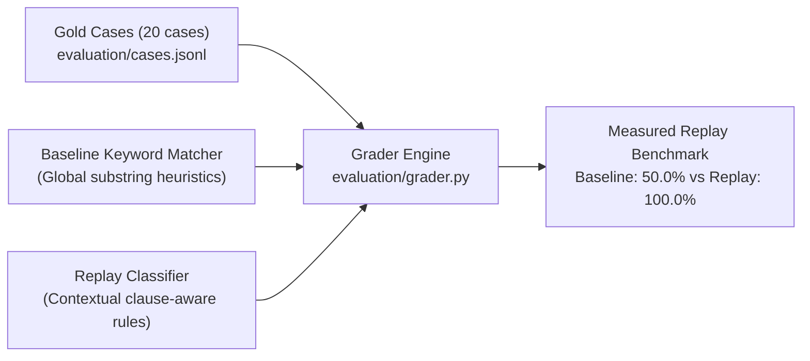

# Evaluation Framework, Methodology & Benchmark Results

## 1. Classification & Evaluation Methodology

To evaluate classifier reliability independently from engineering unit tests, the platform separates **deterministic offline replay** from **live real-model inference** and evaluates them through `evaluation/run_eval.py`.

### Execution Mode Separation
1. **Deterministic Replay (`execution_mode="replay"`, default):**
   * Keyless, reproducible contextual pipeline in `app/llm/replay.py`.
   * Performs citation/URL stripping for semantic prose matching, prompt-echo detection, paragraph/clause-scoped pronoun attribution, target-aware recommendation attribution (allowing positive recommendation and negative caveats to coexist), and target-aware negative characterization (keeping neutral uncertainty separate).
   * Intended for offline regression verification and deterministic scoring mechanics—not as a substitute for live LLM reasoning.
2. **Real-Model Provider (`execution_mode="real_model"`):**
   * Implemented in `app/llm/provider.py` with strict Pydantic v2 validation (`ProviderClassificationOutput`, disallowing unsafe `bool("false")` coercions, out-of-range confidences, or invalid types).
   * Supports an optional `LLM_BASE_URL` setting (defaulting to `https://api.openai.com/v1/chat/completions`) for OpenAI-compatible chat completion APIs. Compatibility depends on the target endpoint adhering to OpenAI-compatible `choices[0].message.content` JSON-mode schemas.
   * Evaluated separately via `python -m evaluation.run_eval --mode real_model`, writing strictly to `evaluation/results/eval_provider_results.json` and `eval_provider_report.md` so replay and provider metrics are never conflated.

### Labeled Evaluation Cases (`evaluation/cases.jsonl`)
The benchmark suite contains **20 gold-standard cases**:
* **8 Supplied Real Cases (`case-001` to `case-008`):** Spanning Gemini, ChatGPT, and Google AI Mode across branded, unbranded, negative, and neutral uncertainty responses.
* **12 Synthetic Regression Cases (`synthetic-001` to `synthetic-012`):**
  * `synthetic-001` & `synthetic-008`: Prompt repetition/echo without actual brand evaluation (`kasparro_mentioned=False`).
  * `synthetic-002`: Explicit negative characterization & caution warning.
  * `synthetic-003`: Competitor recommendation (`"I recommend Profound over Kasparro"`).
  * `synthetic-004`: Competitor negativity in an adjacent sentence while Kasparro description stays neutral.
  * `synthetic-005`: Negated recommendation with poor evidence (`kasparro_recommended=False, kasparro_negative=True`).
  * `synthetic-006`: Neutral insufficient-information statement (`kasparro_negative=False`).
  * `synthetic-007`: Coexisting recommendation + negative caveat (`kasparro_recommended=True, kasparro_negative=True`).
  * `synthetic-009` to `synthetic-012`: Passive practitioner endorsements, double-negation defense (`"not unreliable"` / `"not a scam"`), ambiguous `"It"` after competitor comparison, and subject shifts before anaphora.

---

## 2. Measured Replay Benchmark: Baseline vs. Contextual Replay

Running `python -m evaluation.run_eval` produces the following verified results in `evaluation/results/eval_results.json` (offline replay mode, `contextual-rules-v1`):

| Metric | Rule-Based Baseline | Contextual Replay (`v1`) | Delta |
| :--- | :---: | :---: | :---: |
| **Exact-Match Agreement** | **50.0%** (`10/20`) | **100.0%** (`20/20`) | **+50.0%** |
| Mention Precision | 88.24% (`0.8824`) | 100.0% (`1.0`) | +11.76% |
| Mention Recall | 100.0% (`1.0`) | 100.0% (`1.0`) | 0.0% |
| Recommendation Precision | 37.50% (`0.375`) | 100.0% (`1.0`) | +62.50% |
| Recommendation Recall | 100.0% (`1.0`) | 100.0% (`1.0`) | 0.0% |
| Negative Precision | 50.00% (`0.5`) | 100.0% (`1.0`) | +50.00% |
| Negative Recall | 40.00% (`0.4`) | 100.0% (`1.0`) | +60.00% |

> [!NOTE]
> These metrics reflect offline deterministic **replay** evaluation over the 20 gold cases and do not claim live-model performance. Live provider benchmarks require running `python -m evaluation.run_eval --mode real_model` with valid API credentials.

---

## 3. Verbatim Dataset Evidence & Key Observations

From the 150 archived responses captured on 31 July 2026 across ChatGPT, Gemini, and Google AI Mode:

### Finding 1: Complete Absence in Unbranded Category Searches
* **Observation:** Across all 25 unbranded category prompts (`026`–`050`, 75 responses across Gemini, ChatGPT, and Google AI Mode), Kasparro had `0` mentions (`0.0%` unbranded inclusion). Competitors such as **Profound**, **Peec AI**, and **Otterly** were recommended instead.
* **Verbatim Evidence (`0f38b477-9f3c-44a8-9d10-0b6016db6150`, Gemini):**
  > *"Profound is a powerhouse in the AI visibility space. It tracks an extensive array of engines (10+ platforms including niche models like Grok and DeepSeek)."*

---

### Finding 2: Third-Party Evidence Deficit & ScamAdviser Citations
* **Observation:** ChatGPT responses frequently cited `scamadviser.com` (present in 5 ChatGPT responses) and flagged the lack of independent third-party case studies.
* **Verbatim Evidence (`ac5bdf24-6a6e-49a0-abf5-2755ff3b42bc`, ChatGPT):**
  > *"However, I couldn't find independent evidence showing that Kasparro consistently delivers measurable improvements for B2B SaaS companies specifically. Most of the publicly available material is the company's own positioning rather than third-party case studies with before/after data. [www.scamadviser.com](https://www.scamadviser.com/check-website/kasparro.com?utm_source=chatgpt.com)"*

---

### Finding 3: Phonetic Brand Confusion with "Kaspr"
* **Observation:** Multiple responses confused **Kasparro** with **Kaspr** (a LinkedIn B2B contact-data finder), with `kaspr`-related citations appearing across 19 archived responses.
* **Verbatim Evidence (`1fda2a12-a2df-4ab1-abd5-17b7746bc833`, Gemini / Prompt 011):**
  > *"**Kasparro** (often searched or spelled similarly to *Kaspr*, a well-known LinkedIn contact-data finder) is a legitimate, early-stage B2B SaaS startup operating in the emerging **AI Visibility and Brand Intelligence** space"*
* **Disambiguation Evidence (`1d2dc007-0757-480d-a086-6b6e2e13c463`, ChatGPT / Prompt 018):**
  > *"If you mean **Kasparro** (the B2B SaaS growth/outbound agency, not Kaspr), I couldn't find reliable public pricing or enough verified information to judge whether it's objectively overpriced."*

---

## 4. Prioritized Remedies Roadmap

| Priority | Action Item | Supporting Evidence | Implementation Effort | Validation Metric |
| :---: | :--- | :--- | :---: | :--- |
| **R1** | **Publish 3 Verified Third-Party B2B Case Studies** Address independent evidence deficit and ScamAdviser trust concerns. | `ac5bdf24`, `08f81acc` | **Medium** | Zero `scamadviser.com` citations across prompts `001`–`005` on re-crawl. |
| **R2** | **Establish Profiles on Software Review Directories (G2, Capterra, ProductHunt)** Seed independent category co-occurrence for unbranded buyer discovery. | `0f38b477`, `0697376e`, `a3fdd8bb` | **Low** | Unbranded prompt recall (`026`–`050`) rises above `0.0%` baseline. |
| **R3** | **Deploy JSON-LD Organization Schema & Brand Disambiguation** Separate Kasparro cleanly from Kaspr in crawler entity graphs. | `1d2dc007`, `1fda2a12`, `a3fdd8bb` | **Low** | Zero accidental `kaspr` citation leakage on branded prompts `016`–`019`. |
