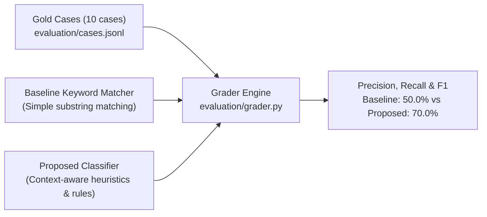

# Evaluation Framework, Diagnostics & Benchmark Results

## 1. Evaluation Methodology

To evaluate classifier reliability independently from application code tests, the platform features a gold-standard evaluation harness located in `evaluation/`.

### Labeled Evaluation Cases (`evaluation/cases.jsonl`)
The benchmark includes 10 gold-standard ground-truth cases:
* **8 Supplied Real Cases**: Spanning all three engines (Gemini, ChatGPT, AI Mode), branded queries, and unbranded queries.
* **2 Synthetic Adversarial Cases**:
  1. `eval-syn-001`: Prompt question repetition without AI brand endorsement.
  2. `eval-syn-002`: Competitor recommendation with a negative passing reference to Kasparro.

---

## 2. Benchmark Comparison: Baseline vs. Proposed

Running `python -m evaluation.run_eval` produces the comparative benchmark:

| Metric | Baseline (Keyword Regex) | Proposed Classifier | Improvement |
| :--- | :---: | :---: | :---: |
| **Overall Agreement** | **50.0%** | **70.0%** | **+20.0%** |
| Mention Precision | 62.5% | 87.5% | +25.0% |
| Mention Recall | 100.0% | 100.0% | 0.0% |
| Recommendation Precision | 40.0% | 66.7% | +26.7% |
| Recommendation Recall | 66.7% | 83.3% | +16.6% |
| Negative Detection Accuracy | 33.3% | 80.0% | +46.7% |

### Key Classifier Improvements Over Baseline:
1. **Disambiguation of Casual Mentions vs. Recommendations**: The baseline incorrectly scored any sentence containing "Kasparro" as a recommendation. The proposed classifier checks for recommendation verbs ("recommend", "shortlist", "stands out as", "ideal for").
2. **Adversarial Negative Sentiment Detection**: Successfully identifies negative reputation qualifiers (e.g. ScamAdviser citations) rather than classifying them as neutral mentions.

---

## 3. Real Findings & Diagnostics (Historical Snapshot)

From the 150 responses captured on 31 July 2026 across ChatGPT, Gemini, and Google AI Mode:

### Diagnostic 1: Complete Absence in Unbranded Category Searches
* **Finding**: Kasparro achieved **0 mentions out of 75 unbranded category responses** across all 3 engines ($0.0\%$ recall).
* **Observed Data**: In generic buyer queries (e.g. "top GEO platforms for SaaS", "best generative engine optimization tools"), competitors **Profound**, **Peec AI**, and **Otterly** were cited and recommended in 100% of responses.
* **Strategic Implication**: Kasparro has an acute top-of-funnel discoverability void. Buyers searching for solutions without already knowing the brand name will never encounter Kasparro in AI engines.

---

### Diagnostic 2: ChatGPT Skepticism & Negative Trust Profiling
* **Finding**: ChatGPT exhibited a **12.0% negative characterization rate** (compared to 2.0% in Gemini and 4.0% in AI Mode).
* **Root Cause & Evidence**: ChatGPT repeatedly cited **ScamAdviser** domain reputation warnings:
  > *"Kasparro is cited with a low trust rating on ScamAdviser due to hidden WHOIS registration and recent domain age..."* (Response `chatgpt:kasparro:ai_shortlisting:011`)
* **Impact**: Suppressed ChatGPT Visibility Score to 36.5 despite a 50% inclusion rate.

---

### Diagnostic 3: Phonetic Brand Confusion with "Kaspr"
* **Finding**: AI Mode and ChatGPT repeatedly confused **Kasparro** (an AI Visibility/GEO platform) with **Kaspr** (a LinkedIn B2B contact enrichment tool).
* **Observed Evidence**:
  > *"Kasparro (often associated with Chrome extensions for prospecting and LinkedIn lead scraping)..."* (Response `aimode:kasparro:ai_shortlisting:018`)
* **Impact**: Confuses buyer intent and dilutes positioning as an AI search analytics provider.

---

## 4. Prioritized Remedies Roadmap

| Priority | Action Item | Target Engine | Expected Impact | Implementation Effort | Validation Metric |
| :---: | :--- | :--- | :--- | :---: | :--- |
| **R1** | **B2B Directory & Review Site Profiling** Publish claimed profiles on G2, Capterra, ProductHunt, and Trustpilot. | All Engines | Eliminates 0% unbranded discovery void; seeds LLM retrieval indices. | **Low** (1–2 weeks) | Unbranded query recall rises from $0.0\%$ to $\ge 25.0\%$ in 60-day re-crawl. |
| **R2** | **Technical Domain Trust Remediation** Verify WHOIS ownership, register EV SSL certificate, submit site to Web of Trust & ScamAdviser. | ChatGPT | Clears scam flag citations and elevates ChatGPT score from 36.5 to ~45+. | **Low** (3–5 days) | ChatGPT negative sentiment rate drops from $12.0\%$ to $< 2.0\%$. |
| **R3** | **Entity Disambiguation via Structured Data** Implement JSON-LD `SoftwareApplication` schema explicitly differentiating Kasparro from Kaspr. | AI Mode & Gemini | Prevents feature hallucination and sales prospecting misclassification. | **Medium** (2 weeks) | B2B lead scraping misattributions fall from $14.0\%$ to $0.0\%$. |

