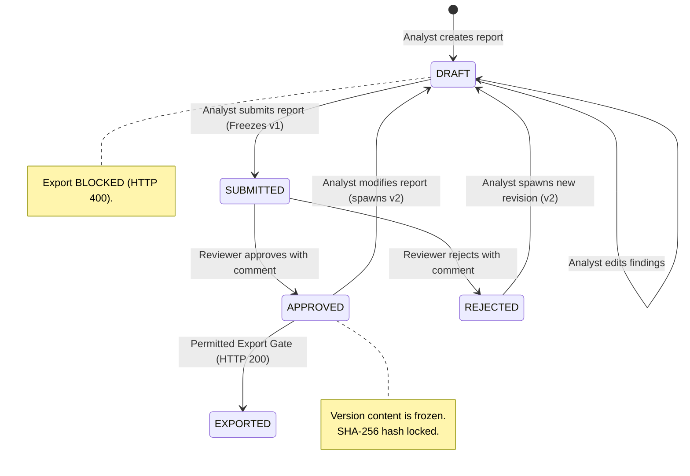
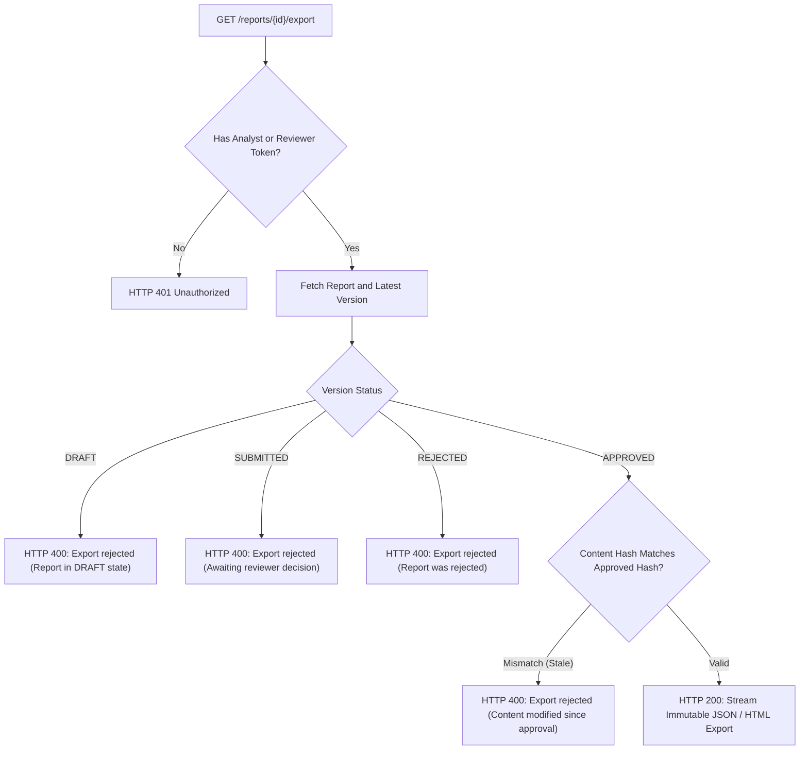

# Human Review Workflow & Immutability Governance

## 1. Governance Principles

Automated AI analytics should never be directly published or exported to clients without human oversight. The Kasparro platform enforces strict governance built on four pillars:

1. **Separation of Duties**: Analysts prepare, analyze, and draft; Reviewers evaluate and sign off.
2. **Version Immutability**: Once a report version is submitted or approved, it is cryptographically locked and can never be modified.
3. **Staleness Invalidation**: Any post-approval edits spawn a new unapproved draft (Version $N+1$). Old approvals do not authorize modified content.
4. **Export Gate Enforcers**: Only an approved version can be downloaded or exported.

---

## 2. Report State Machine



---

## 3. Cryptographic Immutability & Content Hashing

Whenever a report version is created or submitted, the backend computes a canonical SHA-256 hash of its payload:

```python
import hashlib
import json

def compute_content_hash(content: dict) -> str:
    canonical_json = json.dumps(content, sort_keys=True, separators=(",", ":"))
    return hashlib.sha256(canonical_json.encode("utf-8")).hexdigest()
```

### Tamper Detection & Audit Trail
* The `content_hash` is recorded on the `ReportVersion` table.
* Any direct database tampering alters the hash, failing subsequent cryptographic verification.
* All decisions (`approve` or `reject`) are permanently logged in the `ReviewDecision` audit table along with `reviewer_id`, timestamp, and reviewer rationale comments.

---

## 4. The Export Gate Contract

The export endpoint (`GET /reports/{id}/export`) functions as an automated barrier.



### Verification Demonstrations Built Into Test Suite
The following governance scenarios are verified by automated tests in `tests/test_export.py` and `tests/test_permissions.py`:

1. **Analyst Review Denial**: Analyst attempting to call `/decision` receives `HTTP 403 Forbidden`.
2. **Draft Export Denial**: Calling `/export` on a fresh draft returns `HTTP 400 Bad Request`.
3. **Submitted Export Denial**: Calling `/export` on a submitted report awaiting approval returns `HTTP 400 Bad Request`.
4. **Approved Export Success**: Approved report exports clean payload with `status: exported`.
5. **Edit-After-Approval Immutability**: Modifying an approved report increments `version_number` from 1 to 2; Version 1 remains frozen and approved, while Version 2 reverts to `DRAFT` requiring re-review.

